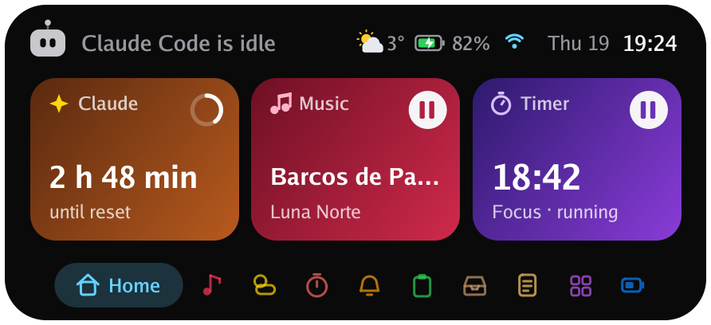
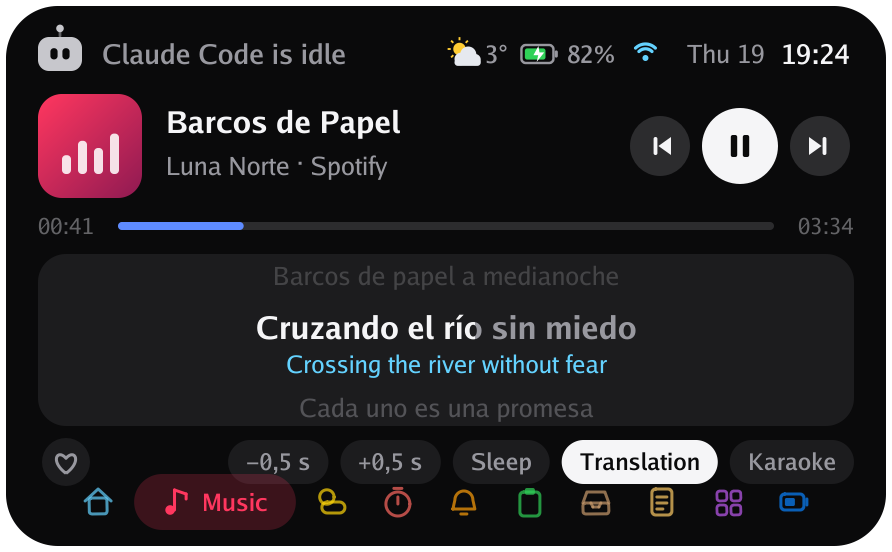
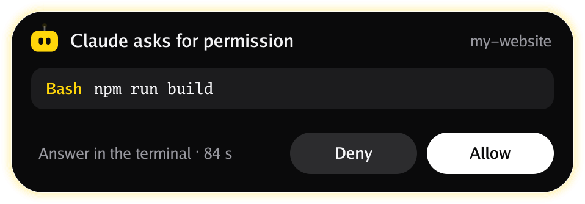
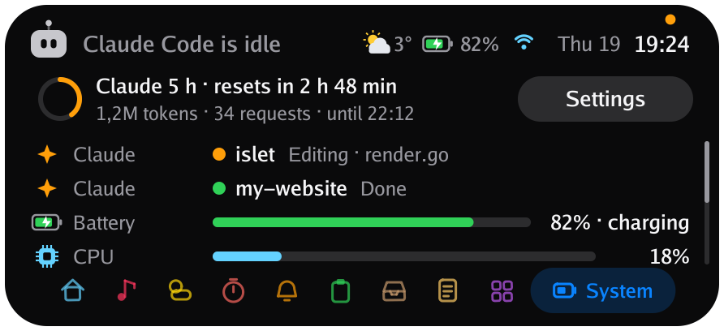
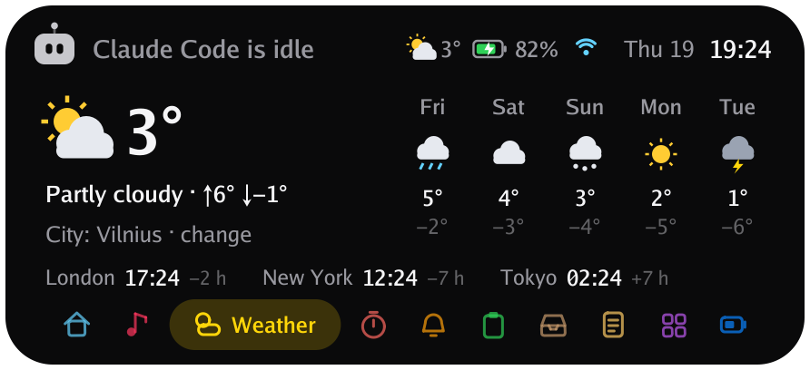
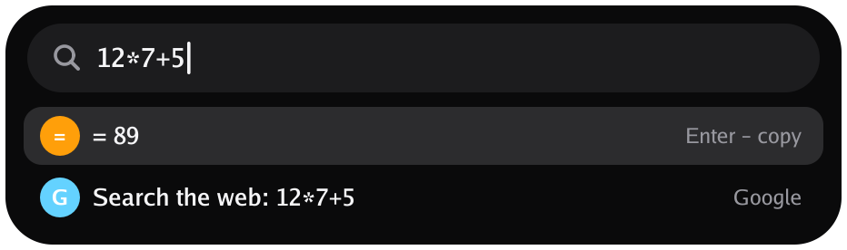

# Islet

**A Dynamic Island–style pill for Windows.** It sits at the top of your screen and shows what Claude Code is doing, what's playing (with synced lyrics), the weather, timers, your clipboard and more. Hover to expand it.

<p align="center">
  
  &nbsp;
  
  &nbsp;
  
</p>

<p align="center">
  
  
</p>
<p align="center">
  
  
</p>
<p align="center">
  
  
</p>

Islet is a single small `.exe` with nothing to install. It is written in Go and talks to Windows directly, with no Electron and no .NET runtime.

---

## Features

**Claude Code**
- Shows what Claude Code is doing right now (thinking, editing a file, running a command) and which project it's working on.
- **Permission requests appear right in the pill.** Click **Allow** or **Deny** without switching to the terminal.
- Plays a sound and turns green when Claude finishes. Several sessions at once are listed in the System tab.
- Shows your **5-hour usage window**: time until reset, tokens and requests. It's counted from Claude Code's local logs.

**Music**
- Now playing from any app that uses Windows media controls: Spotify, YouTube in Chrome or Edge, Apple Music, the Media Player app and others.
- Album art. If the player gives none (common with YouTube), Islet finds the cover online and removes the black video bars.
- **Synced lyrics** from [LRCLIB](https://lrclib.net), with a karaoke fill, a countdown during intros, and an optional translation under each line.
- Click a lyric line to jump to it, or click the progress bar to seek. Use ±0.5 s if the lyrics run early or late.
- Full-screen karaoke page, sleep timer, favourite songs.
- Scroll the mouse wheel over the pill to change the volume. Hold Ctrl and scroll to change screen brightness.

**Tabs**

| Tab | What it does |
|---|---|
| Home | Claude usage, now playing and the timer at a glance |
| Music | Player, progress bar, lyrics, translation, karaoke |
| Weather | Current weather and 5 days ahead ([Open-Meteo](https://open-meteo.com)), up to 3 world clocks |
| Timer | Pomodoro / focus timer with daily and weekly focus stats |
| Plans | To-dos, reminders and today's events from an ICS calendar link |
| Clipboard | Clipboard history: click an item to copy it again |
| Shelf | Drop files on the pill to keep them handy for later |
| Note | A quick note, saved as a plain text file |
| Links | Your quick links, plus tools: area screenshot (with text recognition), full screenshot, colour picker, a mini game |
| System | Battery, CPU, memory, internet speed, brightness, mic/camera in use, Bluetooth device battery, unread Discord/Messenger messages |

**Small things**
- Tells you when a USB drive, mouse, keyboard or phone is plugged in, when a download finishes, and when the internet drops.
- Command bar: a calculator, unit and currency conversion, an app launcher, quick reminders and to-dos, translation and web search.
- Hides itself in full-screen games and videos. Has a Do Not Disturb mode.
- Dark and light themes, three sizes, multi-monitor support.
- Languages: **English, Lithuanian, Russian.**
- A little robot mascot with colours, faces and moods: it sleeps at night and nods along to music.

---

## Download and run

1. Download **`Islet.exe`** from the [latest release](../../releases/latest).
2. Double-click it. A small pill appears at the top of your screen.
3. Windows SmartScreen may warn you because the app isn't code-signed. Click **More info → Run anyway**.

**Requirements:** Windows 10 (version 1809 or newer) or Windows 11, 64-bit.

To start Islet with Windows, right-click the pill and turn on **Start with Windows**.

---

## How to use

### The basics
- **Hover** over the pill to expand it. Move the mouse away and it shrinks back.
- **Click the icons** at the bottom to switch tabs.
- **Right-click** the pill (or the tray icon) for the menu. From there you can open **Settings…**, connect Claude Code, turn on Do Not Disturb, start with Windows or quit.
- **Mouse wheel** over the pill changes the volume. **Ctrl + wheel** changes screen brightness.
- **Drag files** onto the pill to put them on the Shelf.

### Keyboard shortcuts

| Shortcut | Action |
|---|---|
| `Ctrl+Alt+K` | Command bar |
| `Ctrl+Alt+S` | Screenshot of an area |
| `Ctrl+Alt+C` | Colour picker (click anywhere; the colour is copied as HEX) |
| `Ctrl+Alt+D` | Hide / show the pill |

Windows lets only one program own a shortcut. If another app already uses one, Islet automatically takes the next free combination, and the menu and Settings show which one it got. You can record your own shortcuts in **Settings → Shortcuts**.

### Command bar (`Ctrl+Alt+K`)
Type and press **Enter** to run the first result. **Esc** closes it.

| Type | Result |
|---|---|
| `12*7+5` | Calculator, copied with Enter |
| `10 eur usd` | Currency conversion |
| `5 km mi` | Unit conversion |
| `spotify` | Finds and opens an app from the Start menu |
| `remind 20 tea` | Reminder in 20 minutes |
| `todo buy milk` | Adds a to-do |
| `translate hello` | Translates the text |
| `settings`, `weather`, `timer`, `karaoke`, `note`, `game` | Opens that part of Islet |
| anything else | Web search |

### Connecting Claude Code
1. Right-click the pill and turn on **Claude Code connection**. You can also do this in Settings.
2. That's it. Islet adds small HTTP hooks to `~/.claude/settings.json`, so Claude Code reports to the pill. A backup of your original file is saved next to it first.
3. Turning the connection off removes the hooks again.

When Claude Code asks for permission, the pill grows and shows the request. Click **Allow** or **Deny**, or answer in the terminal as usual. If you don't answer within 90 seconds, the question goes back to the terminal.

### Lyrics tips
- During a long intro the pill shows a countdown, e.g. "lyrics in 0:47". Click it to skip to the singing.
- If the lyrics are early or late, use **−0.5 s / +0.5 s** in the Music tab. If the player doesn't report the time (some websites), click the line you're hearing and Islet syncs to it.
- **Translation** translates each line into the app's language.
- **Karaoke** opens a full-screen lyrics page in your browser.

### Settings
Right-click → **Settings…** opens a settings page in your browser. It runs only on your computer at `127.0.0.1`. There you can change:
- language, theme, size and monitor;
- the robot's colour and face;
- which notifications you get, and your shortcuts;
- your city, world clocks, calendar link, birthdays and quick links.

Settings and your data are kept in `%APPDATA%\Islet\`:

| File | Contents |
|---|---|
| `config.json` | Settings |
| `uzrasas.txt` | The Note tab |
| `nuorodos.txt` | Quick links (up to 8), one per line: `Name \| https://…` or `Name \| program` |
| `miestas.txt` | Your city for the weather, if you set one |
| `covers\` | Album art found online |

---

## Privacy

Everything runs on your computer. Islet has no account, no analytics and no server of its own. It only goes online for these features:

| Service | When | What is sent |
|---|---|---|
| [LRCLIB](https://lrclib.net) | A song starts | Song title, artist, duration |
| [Deezer](https://developers.deezer.com) / [iTunes Search](https://performance-partners.apple.com/search-api) | The player gives no album art | Song title and artist |
| Google Translate (web endpoint) | Lyric or clipboard translation is on | The text being translated |
| [Open-Meteo](https://open-meteo.com) | Weather | Coordinates of your city |
| [ipwho.is](https://ipwho.is) | Weather, if you haven't set a city | Your IP address (to guess the city) |
| [Frankfurter](https://www.frankfurter.app) | Currency conversion in the command bar | The two currencies |
| Your calendar link | You added an ICS link | A normal download of that calendar |

The settings and karaoke pages listen only on `127.0.0.1` and need a random per-run token.

---

## Build from source

You need [Go](https://go.dev/dl/) 1.24 or newer. All dependencies are included in `third_party/`, so no downloads are needed.

**On Windows (PowerShell):**
```powershell
.\build.ps1
```

**On Linux / macOS (cross-compile):**
```sh
./build.sh
```

Both produce `Islet.exe`. Run the tests with `go test .`. To re-render the README screenshots, run `ISLET_SHOTS=1 go test -run ReadmeShots .`.

### Project layout
| Files | Contents |
|---|---|
| `main_windows.go`, `app2_windows.go`, `extras_windows.go` | Window, tray, menu, mouse and keyboard handling |
| `render*.go` | All drawing (the pill, tabs, icons) |
| `state.go`, `server.go`, `hooks.go` | Claude Code status, permission queue, hook install |
| `media_windows.go`, `lyrics.go`, `translate.go`, `webcover.go`, `cover.go` | Media, lyrics, translation, album art |
| `web.go` | Settings and karaoke pages |
| `i18n.go`, `i18n_dict.go` | Translations (EN / LT / RU) |
| `features*.go`, `cmdbar.go`, `calendar.go`, `weather.go`, … | Everything else |

---

## Troubleshooting

- **A shortcut doesn't work:** another program probably owns it. Check **Settings → Shortcuts** for the key Islet actually got, or record a new one.
- **No song shown:** the player has to support Windows media controls. Spotify, browsers and most players do. Try pausing and playing once.
- **No lyrics:** LRCLIB doesn't have every song. Songs without words show "Instrumental – no lyrics".
- **Claude Code isn't showing up:** check that **Claude Code connection** is on, then start a new Claude Code session.
- **The pill covers something:** hide it with `Ctrl+Alt+D`, or let it hide automatically in full screen (on by default).

---

## Credits

- Lyrics: [LRCLIB](https://lrclib.net). Weather: [Open-Meteo](https://open-meteo.com). Exchange rates: [Frankfurter](https://www.frankfurter.app).
- Drawing: [fogleman/gg](https://github.com/fogleman/gg) (MIT), [golang/freetype](https://github.com/golang/freetype) (FreeType License), [golang.org/x/image](https://pkg.go.dev/golang.org/x/image) (BSD). Their licenses are in `third_party/`.
- Built with the help of [Claude](https://claude.ai).

Islet is an independent project. It is not affiliated with Apple or Anthropic. "Dynamic Island" is a trademark of Apple Inc. and is used here only to describe the style.

## License

[MIT](LICENSE)
